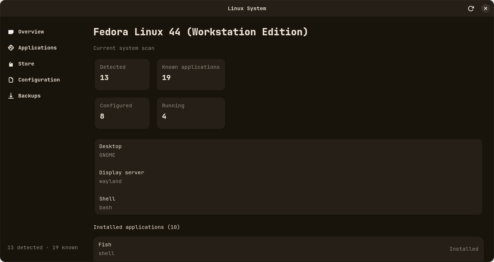

# Panel

Panel's goal is to make Linux desktops easier to understand and manage without hiding the distro
tools that do the actual work. It shows which supported apps appear to be installed, the evidence
behind that result, and where their configuration lives; it also provides reviewed package actions
through the system's existing package managers.

## Install

Requires Python 3.10 or newer and Git. This installs the CLI into a user-owned virtual environment
and does not use `sudo`:

```bash
curl -fsSL https://raw.githubusercontent.com/siefbisnes/Panel/main/install.sh | sh
```

To include the optional GTK interface, first install GTK 4 and the PyGObject build/runtime
dependencies for your distro, then use:

```bash
curl -fsSL https://raw.githubusercontent.com/siefbisnes/Panel/main/install.sh | sh -s -- --gui
```

As with any remote shell installer, review [install.sh](install.sh) before running it. It installs
under `~/.local/share/panel/venv` and links the `panel` command into `~/.local/bin`; it does not
change your system Python or install distro packages.

> **Quick reality check:** this is an early prototype, not a Linux distribution, a replacement for
> your distro's package manager, or a production-ready system-management tool. The app can ask your
> existing package manager to install or remove software, but that does not make its package database
> complete or its recommendations reliable. Definitions and distro coverage are still limited and
> need real users to test, review, and maintain them. Treat results as best-effort, check package names
> before acting, and don't rely on this for critical systems. Contributing is how we start earning
> that trust; it isn't proof of reliability by itself.

The idea is to make some everyday Linux tasks easier to follow without hiding the distro tools and
choices underneath. It's a community-shaped project: shared metadata can help connect different Linux
setups, while each distro and desktop keeps its own character. There's a lot to build and verify, and
that's part of the invitation.

## Screenshots



## Why I'm Building This

I work at a local coding company in Egypt, where I see how much ambition there is across the Linux
community. I believe people from different distros and projects can meet, share what they know, and
build something real together. Panel is my small starting point for that kind of collaboration;
it is still an early project, and it needs contributors to grow into anything dependable.

I'm `altftheoriginal` on Discord: [open my profile](https://discord.com/users/896604385440829481).

## What Works Today

- Scans supported apps using package, executable, desktop-entry, config, process, and service signals.
- Shows the evidence behind detections. A missing or unavailable check can be **unknown**, not a
  definite "not installed".
- Provides a GTK interface with Overview, Applications, Store, Configuration, and About pages.
- Shows compatibility and official documentation when a definition includes those details.
- Opens declared config files and offers controls for reviewed scalar settings in supported formats.
- The CLI can back up and restore declared config files.
- Can request native package installs/removals or per-user Flatpak installs after confirmation.

Definitions are metadata, not scripts: scanning does not execute commands from YAML. Store actions
still change your system through the existing package manager, so read the confirmation and check the
package name before approving an operation.

## Get It Running

Requires Python 3.10 or newer. From a clone:

```bash
python -m venv .venv
.venv/bin/pip install -e ".[dev]"
.venv/bin/panel scan
```

For the GTK app, install GTK 4 and PyGObject, then:

```bash
.venv/bin/pip install -e ".[gui]"
.venv/bin/panel gui
```

If pip cannot install PyGObject on your distro, install the GTK 4 and GObject-introspection Python
bindings using that distro's packages.

## Zsh And Oh My Zsh

Zsh is available from the supported distro repositories. Install it with your distro's package
manager, for example:

```bash
sudo dnf install zsh       # Fedora
sudo pacman -S zsh         # Arch Linux
sudo apt install zsh       # Debian or Ubuntu
```

After Zsh is installed, Oh My Zsh can be installed with its official upstream script (requires
`curl` and `git`):

```bash
sh -c "$(curl -fsSL https://raw.githubusercontent.com/ohmyzsh/ohmyzsh/master/tools/install.sh)"
```

Read the script and the [Oh My Zsh install guidance](https://github.com/ohmyzsh/ohmyzsh/wiki) before
running it. Its installer renames an existing `~/.zshrc` to `~/.zshrc.pre-oh-my-zsh` when present.
Panel can detect Zsh and an Oh My Zsh checkout, but it does not run this upstream installer
for you.

## Useful Commands

```bash
panel                         # quick scan
panel scan                    # overview and detected apps
panel list --all              # include apps not detected on this machine
panel info rofi               # app details and detection evidence
panel config rofi             # show config locations
panel backup rofi             # back up declared configuration
panel restore /path/to/backup --force
panel gui                     # open the GTK app
panel doctor                  # check scanner access and database problems
panel validate                # validate bundled YAML definitions
panel submit --id demo --name Demo --category tool --executable demo
panel community               # database and local submission summary
panel update-db --source URL  # clone/update a community definitions repository
```

`scan`, `list`, and `info` accept `--json`. Add local definitions with `--db DIR`. Native installs
request administrator authentication; Flatpak installs are per-user. Uninstall removes the package,
not the user's configuration.

## Add An App

Want to help? A useful first contribution is one accurate app definition. Add
`database/applications/<id>.yaml`; the file name must match the lowercase `id` in the YAML. For a
personal test, put it under `$XDG_CONFIG_HOME/panel/database/applications/` or load it with
`--db DIR`. `panel submit` can also make a local draft, but it does not publish it. For a
shared definition, open a pull request so someone else can review it.

Here's a package mapping based on the bundled Firefox definition:

```yaml
packages:
  fedora:
    - firefox
  arch:
    - firefox
  debian:
    - firefox
    - firefox-esr
  flatpak:
    - org.mozilla.firefox
```

Package keys currently supported are `fedora`, `arch`, `debian`, `opensuse`, and `flatpak`. Use each
distro's exact repository package name; for Flatpak, use the exact Flathub application ID. A package
name is not necessarily the app's display name or executable. Check package metadata and confirm the
package actually provides this app before adding it. Leave unverified distro keys out rather than
guessing.

The order matters: the Store tries the **first** mapped native package for a new install. Later names
can help detect installed variants, but are not retries if the first install fails. Flatpak is used
when no usable native mapping/backend is available, not as an automatic fallback after a failed native
install. Validate the YAML, check names against the distro's package index, and mention your evidence
and test environment in the PR. See the guide for lookup commands, safe install testing, and the full
contributor checklist: [Adding an application](docs/adding-an-application.md).

## How Detection Works

Each definition lists the signals to check. A signal is **found**, **not found**, or **unknown**. For
example, package status may be unknown if the local package manager cannot be queried. The scanner
checks package indexes, `$PATH`, desktop entries, declared config paths, `/proc`, and systemd where
available. Configuration by itself means a config file exists; it does not prove the app is installed.

## Where Definitions Come From

Definitions load in this order, with later entries overriding earlier ones that have the same `id`:

1. Bundled: `database/applications/`
2. Community: `$XDG_DATA_HOME/panel/community-db`
3. Personal: `$XDG_CONFIG_HOME/panel/database/`
4. Extra directories passed with `--db DIR`

## Help Build It

Start small: verify one app's package names and detection signals, run the validator, then open a PR
with links or notes showing how you checked the details. Good metadata beats a long list of guesses.
The project needs testing across real distros and desktops before anyone should treat its coverage as
complete or dependable.

```bash
.venv/bin/panel validate
.venv/bin/python -m pytest -q
```

The full contributor guide is [docs/adding-an-application.md](docs/adding-an-application.md). Thanks
for helping make this more useful, one checked definition at a time.
